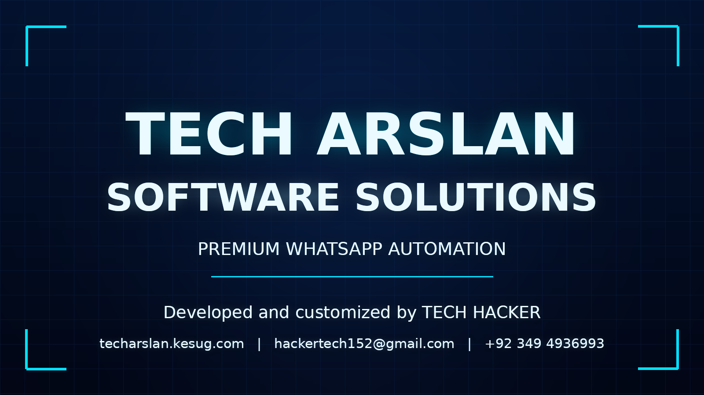

<p align="center">
  
</p>

<h1 align="center">TECH ARSLAN SOFTWARE SOLUTIONS</h1>

<p align="center">
  <b>Premium WhatsApp Multi-Device Automation Bot</b><br/>
  Developed and customized by <b>TECH HACKER</b>
</p>

<p align="center">
  <a href="https://techarslan.kesug.com"></a>
  <a href="mailto:hackertech152@gmail.com"></a>
  <a href="https://wa.me/923494936993"></a>
</p>

<p align="center">
  
  
  
  
</p>

---

## Table of contents

- [Overview](#overview)
- [Feature set](#feature-set)
- [Requirements](#requirements)
- [VPS deployment (Ubuntu 22.04 / 24.04)](#vps-deployment-ubuntu-2204--2404)
- [Configuration](#configuration)
- [Running with PM2](#running-with-pm2)
- [Connecting your WhatsApp](#connecting-your-whatsapp)
- [Project structure](#project-structure)
- [AI providers](#ai-providers)
- [Troubleshooting](#troubleshooting)
- [Branding and attribution](#branding-and-attribution)
- [License](#license)

---

## Overview

TECH ARSLAN SOFTWARE SOLUTIONS is a Baileys-based WhatsApp Multi-Device bot
that runs on Node.js. It ships with downloaders, AI chat, group management,
sticker tools, image/audio utilities and an owner command set. This build is a
rebranded and customized distribution of the Apache-2.0 licensed KHAN-MD
project; see [`NOTICE`](NOTICE).

---

## Feature set

**Downloaders** — YouTube video and MP3, TikTok, Instagram, Facebook,
Pinterest, Twitter/X, Spotify, SoundCloud, MediaFire, Google Drive, APK,
wallpapers and more.

**AI chatbot** — Google Gemini, OpenAI, Claude and DeepSeek with per-chat
conversation context. Providers are configurable through environment variables.

**Group management** — promote/demote, kick/add (where permitted), tag all,
anti-link, anti-spam, welcome/goodbye, group info, admin-only commands.

**Additional** — sticker maker, image and video converters, audio tools, QR
generator, games, plugin system and owner-only commands.

Run `.menu` in WhatsApp for the live, always-current command list.

---

## Requirements

- Ubuntu 22.04 LTS or Ubuntu 24.04 LTS (x86_64)
- Node.js 20 or newer
- FFmpeg (for media conversion and sticker generation)
- PM2 (process manager)
- A WhatsApp account to pair

---

## VPS deployment (Ubuntu 22.04 / 24.04)

Clone the repository, then run the installer as root.

```bash
git clone https://github.com/akhs57104-dot/Arslan.ak.bot_0.2.git
cd Arslan.ak.bot_0.2
sudo bash scripts/install.sh
```

The installer installs Node.js 20, FFmpeg, build tools and PM2, then runs
`npm install` and creates `config.env` from `config.env.example`.

Helper scripts:

| Script | Purpose |
| --- | --- |
| `scripts/install.sh` | Install Node.js, FFmpeg, PM2 and dependencies |
| `scripts/start.sh` | Start the bot under PM2 and save the process list |
| `scripts/stop.sh` | Stop the PM2 process |
| `scripts/restart.sh` | Restart the PM2 process |
| `scripts/update.sh` | Pull the latest code, reinstall deps, restart |

### Manual install (without the script)

```bash
curl -fsSL https://deb.nodesource.com/setup_20.x | sudo -E bash -
sudo apt-get install -y nodejs ffmpeg
sudo npm install -g pm2
npm install
```

---

## Configuration

Copy the example file and edit it.

```bash
cp config.env.example config.env
nano config.env
```

`config.js` reads the following keys from the environment (defaults are applied
when a key is absent):

| Key | Description |
| --- | --- |
| `SESSION_ID` | WhatsApp session string. Required to start the bot. |
| `PAIR_API` | Optional pairing-code service used by `.pair`. |
| `BOT_NAME` | Bot display name (defaults to TECH ARSLAN SOFTWARE SOLUTIONS). |
| `STICKER_NAME` | Sticker pack name. |
| `PREFIX` | Command prefix (default `.`). |
| `MODE` | `public` or `private`. |
| `OWNER_NUMBER` / `OWNER_NAME` | Bot owner details. |
| `BRAND_NAME`, `WEBSITE`, `EMAIL`, `OWNER_WHATSAPP`, `OWNER_WHATSAPP_INTL` | Company branding used in menus and messages. |
| `AI_PROVIDER` | Default AI provider for `.ai`: `gemini`, `openai`, `claude`, `deepseek`. |
| `GEMINI_API_KEY`, `OPENAI_API_KEY`, `CLAUDE_API_KEY`, `DEEPSEEK_API_KEY` | Keys for the matching AI providers. |
| `OPENWEATHER_API_KEY`, `NEWS_API_KEY` | Optional overrides for `.weather` and `.news`. |

Boolean toggles (`AUTO_STATUS_SEEN`, `ANTI_LINK`, `WELCOME`, `ALWAYS_ONLINE`,
and others) accept `true` or `false`. See `config.env.example` for the full list.

---

## Running with PM2

```bash
bash scripts/start.sh        # start and save
pm2 logs tech-arslan-software-solutions
bash scripts/restart.sh      # restart
bash scripts/stop.sh         # stop
pm2 save                     # persist across reboots
pm2 startup                  # register boot startup (once)
```

The PM2 process is defined in `ecosystem.config.js`.

---

## Connecting your WhatsApp

1. Set `SESSION_ID` in `config.env` (or use the `.pair` command if `PAIR_API`
   is configured).
2. Start the bot: `bash scripts/start.sh`.
3. If pairing by code, open WhatsApp → Linked devices → Link with phone number
   and enter the code the bot prints.

---

## Project structure

```
.
├── index.js               # entry point (starts Baileys + plugin loader)
├── config.js              # reads config.env, exports settings
├── command.js             # command registry (cmd())
├── ecosystem.config.js    # PM2 process definition
├── config.env.example     # environment template
├── plugins/               # one file per command / feature group
├── lib/                   # shared helpers (database, ai, functions, events)
├── assets/                # menu media and branding assets
│   └── branding/          # logo, banner, menu, profile, sticker assets
├── scripts/               # install / start / stop / restart / update
├── Dockerfile             # container build
├── heroku.yml, koyeb.yaml # PaaS manifests
└── NOTICE, LICENSE        # attribution and license
```

---

## AI providers

The `.ai` command uses the provider in `AI_PROVIDER`; `.openai`, `.claude` and
`.deepseek` force a specific provider. `.clearchat` resets the conversation
context for the current chat. Each provider needs its matching API key.

```bash
AI_PROVIDER=gemini
GEMINI_API_KEY=your-key
```

Provider base URLs and model names can be overridden with `GEMINI_API_BASE`,
`GEMINI_MODEL`, `OPENAI_API_BASE`, `OPENAI_MODEL`, `CLAUDE_API_BASE`,
`CLAUDE_MODEL`, `DEEPSEEK_API_BASE` and `DEEPSEEK_MODEL`.

---

## Troubleshooting

| Symptom | Fix |
| --- | --- |
| `Please add your session to SESSION_ID env !!` | Set `SESSION_ID` in `config.env`. |
| Media commands fail | Confirm FFmpeg is installed: `ffmpeg -version`. |
| AI commands report "not configured" | Set `AI_PROVIDER` and the matching API key. |
| Bot restarts repeatedly | Check `pm2 logs tech-arslan-software-solutions`. |
| Session logged out | Re-pair and update `SESSION_ID`. |

---

## Branding and attribution

This is a rebranded distribution. The original project, author, license and
attribution notices are preserved in [`NOTICE`](NOTICE) and [`LICENSE`](LICENSE).

- Company: TECH ARSLAN SOFTWARE SOLUTIONS
- Developed and customized by: TECH HACKER
- Website: https://techarslan.kesug.com
- Email: hackertech152@gmail.com
- WhatsApp: 03494936993 (international: +92 349 4936993)

---

## License

Licensed under the Apache License 2.0. See [`LICENSE`](LICENSE).

> This bot is not affiliated with WhatsApp Inc. Use at your own risk.
