<div align="center">



<br/><br/>


<br/>

<a href="https://techarslan.kesug.com"></a>
<a href="mailto:hackertech152@gmail.com"></a>
<a href="https://wa.me/923494936993"></a>

<br/>


</div>

---

## ⚡ Quick actions

<div align="center">

<a href="https://github.com/akhs57104-dot/Arslan.ak.bot_0.2/fork"></a>
<a href="https://github.com/akhs57104-dot/Arslan.ak.bot_0.2"></a>
<a href="https://github.com/akhs57104-dot/Arslan.ak.bot_0.2/issues"></a>
<a href="https://github.com/akhs57104-dot/Arslan.ak.bot_0.2/archive/refs/heads/main.zip"></a>

</div>

---

## 🔑 Get your Session ID

<div align="center">

<a href="https://khanmd-pairx.onrender.com/"></a>

<sub>Tap the button to open the pairing site, generate your <b>SESSION_ID</b>, then paste it into <code>config.env</code>.</sub>

</div>

---

## ☁️ One-click deploy

<div align="center">

<a href="https://railway.app/new/template?template=https%3A%2F%2Fgithub.com%2Fakhs57104-dot%2FArslan.ak.bot_0.2"></a>
<a href="https://render.com/deploy?repo=https%3A%2F%2Fgithub.com%2Fakhs57104-dot%2FArslan.ak.bot_0.2"></a>
<a href="https://app.koyeb.com/deploy?type=git&repository=github.com%2Fakhs57104-dot%2FArslan.ak.bot_0.2&branch=main&name=tech-arslan-bot&builder=buildpack"></a>
<a href="https://heroku.com/deploy?template=https%3A%2F%2Fgithub.com%2Fakhs57104-dot%2FArslan.ak.bot_0.2"></a>

<br/>

<a href="https://replit.com/github/akhs57104-dot/Arslan.ak.bot_0.2"></a>
<a href="https://codespaces.new/akhs57104-dot/Arslan.ak.bot_0.2"></a>
<a href="https://github.com/akhs57104-dot/Arslan.ak.bot_0.2/blob/main/Dockerfile"></a>
<a href="https://github.com/akhs57104-dot/Arslan.ak.bot_0.2/blob/main/ecosystem.config.js"></a>

</div>

> ⚠️ Free PaaS tiers sleep or reset storage. WhatsApp sessions live in `sessions/`, so a **VPS or a persistent-volume host** is recommended for 24/7 uptime. See [VPS deployment](#-vps-deployment-ubuntu-2204--2404).

---

## 📖 Table of contents

- [Overview](#-overview)
- [Feature set](#-feature-set)
- [Requirements](#-requirements)
- [Quick start](#-quick-start)
- [VPS deployment (Ubuntu 22.04 / 24.04)](#-vps-deployment-ubuntu-2204--2404)
- [Docker](#-docker)
- [Configuration](#-configuration)
- [Running with PM2](#-running-with-pm2)
- [Connecting your WhatsApp](#-connecting-your-whatsapp)
- [Project structure](#-project-structure)
- [AI providers](#-ai-providers)
- [Troubleshooting](#-troubleshooting)
- [Branding and attribution](#-branding-and-attribution)
- [License](#-license)

---

## 🧭 Overview

**TECH ARSLAN SOFTWARE SOLUTIONS** is a Baileys-based **WhatsApp Multi-Device**
bot that runs on Node.js. It ships with downloaders, an AI chatbot, group
management, sticker tools, image/audio utilities and an owner command set.

This build is a rebranded and customized distribution of the Apache-2.0
licensed KHAN-MD project; see [`NOTICE`](NOTICE).

---

## 🧩 Feature set

| Area | Highlights |
| --- | --- |
| **Downloaders** | YouTube video & MP3, TikTok, Instagram, Facebook, Pinterest, Twitter/X, Spotify, SoundCloud, MediaFire, Google Drive, APK, wallpapers |
| **AI chatbot** | Google Gemini, OpenAI, Claude, DeepSeek — with per-chat conversation context and a `.clearchat` reset |
| **Group management** | Promote/demote, kick/add (where permitted), tag all, anti-link, anti-spam, welcome/goodbye, group info, admin-only commands |
| **Stickers & media** | Sticker maker, image & video converters, audio tools, QR generator |
| **Extras** | Games, plugin system, owner-only commands, auto status seen/react |

Run `.menu` in WhatsApp for the live, always-current command list.

---

## 🛠 Requirements

- Ubuntu 22.04 LTS or Ubuntu 24.04 LTS (x86_64) — or Docker / a PaaS host
- Node.js 20 or newer
- FFmpeg (media conversion and sticker generation)
- PM2 (process manager) — for VPS
- A WhatsApp account to pair

---

## 🚀 Quick start

```bash
git clone https://github.com/akhs57104-dot/Arslan.ak.bot_0.2.git
cd Arslan.ak.bot_0.2
cp config.env.example config.env
nano config.env          # set SESSION_ID (or PAIR_NUMBER)
npm install
npm start
```

---

## 🖥 VPS deployment (Ubuntu 22.04 / 24.04)

Clone the repository, then run the installer as root.

```bash
git clone https://github.com/akhs57104-dot/Arslan.ak.bot_0.2.git
cd Arslan.ak.bot_0.2
sudo bash scripts/install.sh
```

The installer installs Node.js 20, FFmpeg, build tools and PM2, then runs
`npm install` and creates `config.env` from `config.env.example`.

| Script | Purpose |
| --- | --- |
| `scripts/install.sh` | Install Node.js, FFmpeg, PM2 and dependencies |
| `scripts/start.sh` | Start the bot under PM2 and save the process list |
| `scripts/stop.sh` | Stop the PM2 process |
| `scripts/restart.sh` | Restart the PM2 process |
| `scripts/update.sh` | Pull the latest code, reinstall deps, restart |

### Manual install (without the script)

```bash
curl -fsSL https://deb.nodesource.com/setup_20.x | sudo -E bash -
sudo apt-get install -y nodejs ffmpeg
sudo npm install -g pm2
npm install
```

---

## 🐳 Docker

```bash
docker build -t tech-arslan-bot .
docker run -d --name tech-arslan-bot \
  -e SESSION_ID="your-session-id" \
  -p 9090:9090 \
  --restart unless-stopped \
  tech-arslan-bot
```

---

## 🚂 Deploying on Railway / Render / Koyeb

The repo ships `nixpacks.toml` (installs Node.js 20 + ffmpeg), `Procfile` and
`Dockerfile`, so Railway builds work out of the box.

Set these variables in the platform dashboard:

| Variable | Value |
| --- | --- |
| `SESSION_ID` | Your session string **or** leave empty and set `PAIR_NUMBER` |
| `PAIR_NUMBER` | Your WhatsApp number, digits only, e.g. `923494936993` |
| `SYNC_FULL_HISTORY` | `false` (keeps memory low on small plans) |

Notes for free/hobby plans:

- **Sessions live in `sessions/`.** Without a persistent volume the container is
  rebuilt from scratch, so you must re-pair after every redeploy. Attach a
  Railway volume (or Render disk) mounted at `/app/sessions` for persistence.
- **Free plans sleep.** Railway trial, Render free and Koyeb free instances
  sleep or reset, which drops the WhatsApp socket. Use a VPS or a paid plan for
  24/7 uptime.
- **ffmpeg** is installed by `nixpacks.toml` / `Dockerfile`; if you use a custom
  buildpack, install it yourself or media commands will fail.

---

## ⚙️ Configuration

Copy the example file and edit it.

```bash
cp config.env.example config.env
nano config.env
```

`config.js` reads the following keys from the environment (defaults apply when a
key is absent):

| Key | Description |
| --- | --- |
| `SESSION_ID` | WhatsApp session string. Required to start the bot. |
| `PAIR_NUMBER` | International number (digits only) to pair by code on startup. |
| `PAIR_API` | Optional pairing-code service used by `.pair`. |
| `BOT_NAME` | Bot display name (defaults to TECH ARSLAN SOFTWARE SOLUTIONS). |
| `STICKER_NAME` | Sticker pack name. |
| `PREFIX` | Command prefix (default `.`). |
| `MODE` | `public` or `private`. |
| `OWNER_NUMBER` / `OWNER_NAME` | Bot owner details. |
| `BRAND_NAME`, `WEBSITE`, `EMAIL`, `OWNER_WHATSAPP`, `OWNER_WHATSAPP_INTL` | Company branding used in menus and messages. |
| `AI_PROVIDER` | Default AI provider for `.ai`: `gemini`, `openai`, `claude`, `deepseek`. |
| `GEMINI_API_KEY`, `OPENAI_API_KEY`, `CLAUDE_API_KEY`, `DEEPSEEK_API_KEY` | Keys for the matching AI providers. |
| `OPENWEATHER_API_KEY`, `NEWS_API_KEY` | Optional overrides for `.weather` and `.news`. |

Boolean toggles (`AUTO_STATUS_SEEN`, `ANTI_LINK`, `WELCOME`, `ALWAYS_ONLINE`,
and others) accept `true` or `false`. See `config.env.example` for the full list.

---

## ♻️ Running with PM2

```bash
bash scripts/start.sh        # start and save
pm2 logs tech-arslan-software-solutions
bash scripts/restart.sh      # restart
bash scripts/stop.sh         # stop
pm2 save                     # persist across reboots
pm2 startup                  # register boot startup (once)
```

The PM2 process is defined in `ecosystem.config.js`.

---

## 📱 Connecting your WhatsApp

1. Open the [pairing site](https://khanmd-pairx.onrender.com/) and generate a
   **SESSION_ID**, then set it in `config.env` — or set `PAIR_NUMBER` to pair by
   code on startup.
2. Start the bot: `bash scripts/start.sh`.
3. If pairing by code, open WhatsApp → Linked devices → Link with phone number
   and enter the code the bot prints.

---

## 🗂 Project structure

```
.
├── index.js               # entry point (starts Baileys + plugin loader)
├── config.js              # reads config.env, exports settings
├── command.js             # command registry (cmd())
├── ecosystem.config.js    # PM2 process definition
├── config.env.example     # environment template
├── plugins/               # one file per command / feature group
├── lib/                   # shared helpers (database, ai, functions, events)
├── assets/                # menu media and branding assets
│   └── branding/          # logo, banner, animated banner, menu, profile
├── scripts/               # install / start / stop / restart / update
├── Dockerfile             # container build
├── heroku.yml, koyeb.yaml # PaaS manifests
└── NOTICE, LICENSE        # attribution and license
```

---

## 🤖 AI providers

The `.ai` command uses the provider in `AI_PROVIDER`; `.openai`, `.claude` and
`.deepseek` force a specific provider. `.clearchat` resets the conversation
context for the current chat. Each provider needs its matching API key.

```bash
AI_PROVIDER=gemini
GEMINI_API_KEY=your-key
```

Provider base URLs and model names can be overridden with `GEMINI_API_BASE`,
`GEMINI_MODEL`, `OPENAI_API_BASE`, `OPENAI_MODEL`, `CLAUDE_API_BASE`,
`CLAUDE_MODEL`, `DEEPSEEK_API_BASE` and `DEEPSEEK_MODEL`.

---

## 🧯 Troubleshooting

| Symptom | Fix |
| --- | --- |
| `Please add your session to SESSION_ID env !!` | Set `SESSION_ID` in `config.env`, or set `PAIR_NUMBER`. |
| Media commands fail | Confirm FFmpeg is installed: `ffmpeg -version`. |
| AI commands report "not configured" | Set `AI_PROVIDER` and the matching API key. |
| Bot restarts repeatedly | Check `pm2 logs tech-arslan-software-solutions`. |
| Session logged out | Re-pair and update `SESSION_ID`. |
| PaaS resets session | Use a VPS or persistent volume for `sessions/`. |

---

## 🎨 Branding and attribution

This is a rebranded distribution. The original project, author, license and
attribution notices are preserved in [`NOTICE`](NOTICE) and [`LICENSE`](LICENSE).

- **Company:** TECH ARSLAN SOFTWARE SOLUTIONS
- **Developed and customized by:** TECH HACKER
- **Website:** https://techarslan.kesug.com
- **Email:** hackertech152@gmail.com
- **WhatsApp:** 03494936993 (international: +92 349 4936993)

---

## 📜 License

Licensed under the Apache License 2.0. See [`LICENSE`](LICENSE).

> This bot is not affiliated with WhatsApp Inc. Use at your own risk.

<div align="center">

<br/>


<sub>© TECH ARSLAN SOFTWARE SOLUTIONS — Developed and customized by TECH HACKER</sub>

</div>
